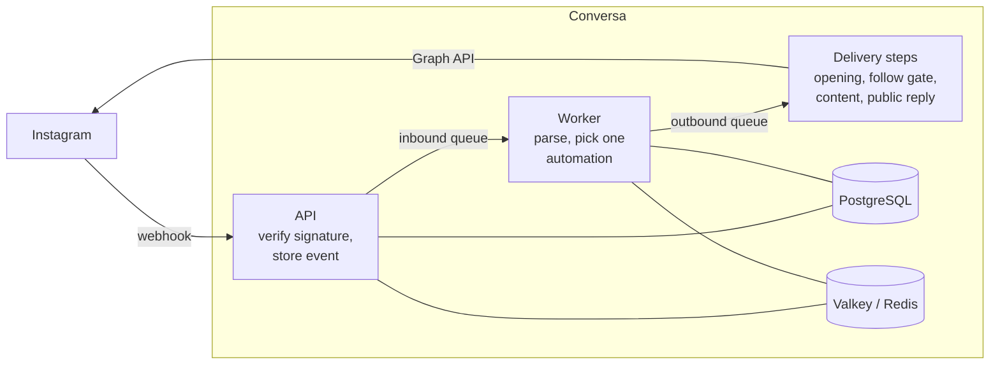

# Conversa

**Self-hosted, open-source automation for Instagram comments and direct messages, and TikTok direct messages.**

Someone comments `LINK` on your post and gets the link in their DMs a second later. Someone replies to your story and gets an answer. Conversa does this on your own server, for as many Instagram accounts and teams as you need, and it answers TikTok direct messages too, with more platforms possible behind the same provider interface.

MIT licensed. Your data stays in your own PostgreSQL database.

## Features

**Automations**

- **Comment to DM.** A comment that matches your keywords gets a private reply in the commenter's inbox.
- **Keyword matching that forgives how people type.** Case, accents, emoji and punctuation are ignored (`PRECIO!!` matches `precio`). Whole-word matching is on by default, so `info` does not fire on `information`. Or answer anything.
- **DM triggers**, including replies to your stories.
- **Public reply variants.** Optionally answer under the comment too, with one of up to five texts picked at random so the replies do not look like a bot.
- **Opening message and follow gate.** Send a short message with a button first, and optionally ask the person to follow you before the content arrives.
- **Link buttons with click tracking.** Up to three buttons per message; every link goes through a tracked redirect so you can see who clicked.
- **Post scopes.** Listen to every post, chosen posts, **the next post you publish**, or **a post scheduled in Buffer**: the automation binds itself to the post once it goes live.
- **Once per contact**, so nobody gets the same message twice.

**Teams and accounts**

- Multiple workspaces per installation, and multiple Instagram and TikTok accounts per workspace.
- **TikTok:** keyword DM automations with the opening message, follow gate and tracked links. TikTok cannot message comment authors, so its accounts answer direct messages only.
- Roles: owner, admin and member, with email invitations.
- Contacts, an activity log of every delivery and why it was sent, skipped or failed, an inbox to read and answer conversations, a content view of your posts, and a dashboard.
- An audit log of who changed what.
- Instance settings in the app for instance admins: email, the Meta and TikTok apps, Turnstile and sign-up, with a first-run setup guide. Nothing to restart.

**Everything else**

- English and Spanish interface (and emails), chosen per person.
- Two-factor authentication with an authenticator app and recovery codes.
- **Sandbox mode:** a simulated Instagram and TikTok to try every feature without a Meta or TikTok app.
- One `docker compose` file for production, with an optional Cloudflare Tunnel.

## How it works



1. Instagram calls the webhook. The API checks the HMAC signature, stores the raw event and queues it, then answers `200` at once.
2. The worker parses the event, records the contact, and picks **at most one** automation: the most specific one wins (a post-bound automation over an "every post" one, a keyword match over "anything", then the newest).
3. A delivery is created — once per comment or message, however often Instagram redelivers the webhook — and moves through its steps. Each step is safe to retry and never sends twice.
4. Sends respect Instagram's limits: 750 private replies per hour per account, shared by every worker.

More in [docs/architecture.md](docs/architecture.md).

## Quick start (local development)

You need Node.js 22.12+ (`.nvmrc`), pnpm 11 and Docker for PostgreSQL, Valkey and Mailpit.

```bash
pnpm install
cp .env.example .env
pnpm secrets:generate   # prints SECRET_KEY, ENCRYPTION_KEY, ... paste them into .env
pnpm infra:up           # PostgreSQL, Valkey and Mailpit (mail UI on http://localhost:8025)
pnpm db:migrate
pnpm dev                # API on :4000 and web on :3000
pnpm dev:worker         # in a second terminal: the queue worker
```

Open http://localhost:3000. The first account you create becomes the instance admin and the owner of its first workspace, and is walked through a short setup: email, the Instagram app and Turnstile, each skippable. All three live in the app under **Instance settings**, not in `.env`. For Mailpit, use server `localhost`, port `1025`, no encryption.

**No Meta app yet?** Set `INSTAGRAM_SANDBOX=true` in `.env` and restart. You can then connect fake Instagram accounts, simulate comments, messages and button taps from the channels page, and watch the whole pipeline run. See [docs/sandbox.md](docs/sandbox.md).

To connect a real account, follow [docs/instagram.md](docs/instagram.md). Instagram must reach your webhook over HTTPS, so for local testing put the app behind a tunnel.

## Deploying

The production stack is [`docker/compose.yml`](docker/compose.yml): PostgreSQL, Valkey, a one-shot migration job, the API, the worker and the web server. Only the web server publishes a port, on `127.0.0.1` by default.

- [Self-hosting](docs/self-hosting.md): configuration reference, migrations, backups, upgrades, scaling.
- [Cloudflare](docs/cloudflare.md): Tunnel, WAF rules, Turnstile, Access.
- [Instagram](docs/instagram.md): creating the Meta app and going live.
- [TikTok](docs/tiktok.md): the TikTok developer app, messaging access and what TikTok allows.
- [Buffer](docs/buffer.md): attaching automations to scheduled posts.

## Tech stack

| Part           | Built with                                                                                                          |
| -------------- | ------------------------------------------------------------------------------------------------------------------- |
| API and worker | NestJS 12 (ESM), Prisma 7, PostgreSQL 17, BullMQ on Valkey (Redis-compatible), pino                                 |
| Web            | Next.js 16 (App Router), React 19, TanStack Query, next-intl, Tailwind CSS 4                                        |
| UI             | [Mola UI](https://demogar.github.io/molaui/) (`@demogar/mola-ui`), a design system of flat layers and hard keylines |
| Shared         | `@conversa/shared`: zod schemas, DTOs, error codes, keyword matching                                                |
| Tests          | Jest with SWC, React Testing Library, Playwright                                                                    |

## Project structure

```
apps/
  api/            NestJS API (src/main.ts) and queue worker (src/worker.ts)
    prisma/       schema and migrations
    src/modules/  one folder per feature: auth, workspaces, channels, engine, webhooks, buffer, ...
  web/            Next.js app
    messages/     en/ and es/ translations, one JSON file per area
    src/app/      routes
    src/features/ screens, one folder per area
packages/
  shared/         contracts shared by the API and the web app
docker/           production and development compose files, Dockerfiles
docs/             guides for operators and contributors
scripts/          repository scripts (secret generation)
```

## Security

Passwords are hashed with argon2id; sessions are server-side, stored hashed and carried in an httpOnly `__Host-` cookie; every state-changing request is origin-checked; provider tokens and API keys are encrypted at rest with AES-256-GCM; webhooks are signature-verified; the web app sends a strict nonce-based Content Security Policy. Details and how to report a vulnerability privately: [SECURITY.md](SECURITY.md).

## Contributing

Contributions are welcome. Start with [CONTRIBUTING.md](CONTRIBUTING.md), then the [backend](docs/contributing/backend-guide.md) or [frontend](docs/contributing/frontend-guide.md) guide. Please follow the [code of conduct](CODE_OF_CONDUCT.md).

## License

[MIT](LICENSE)
