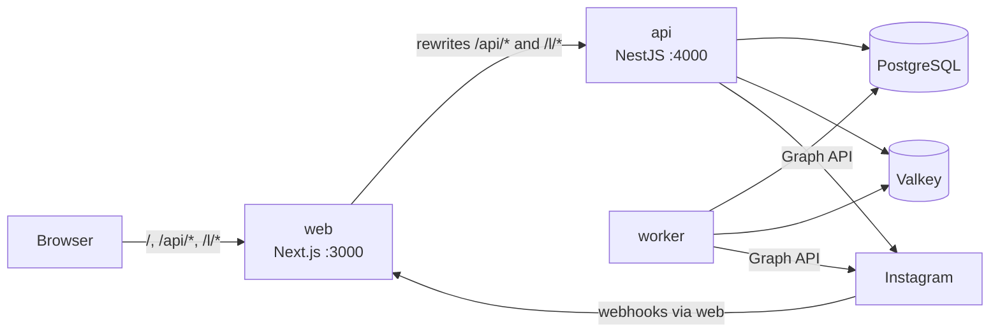
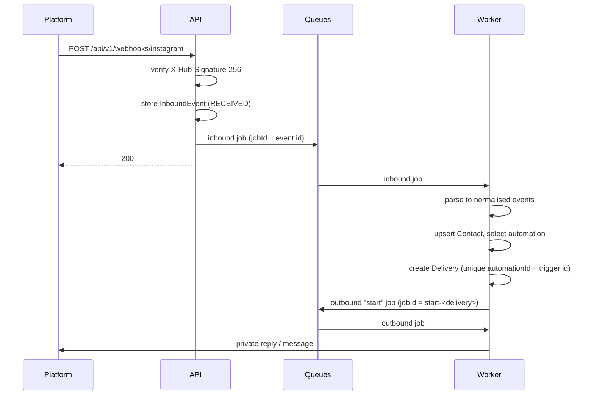
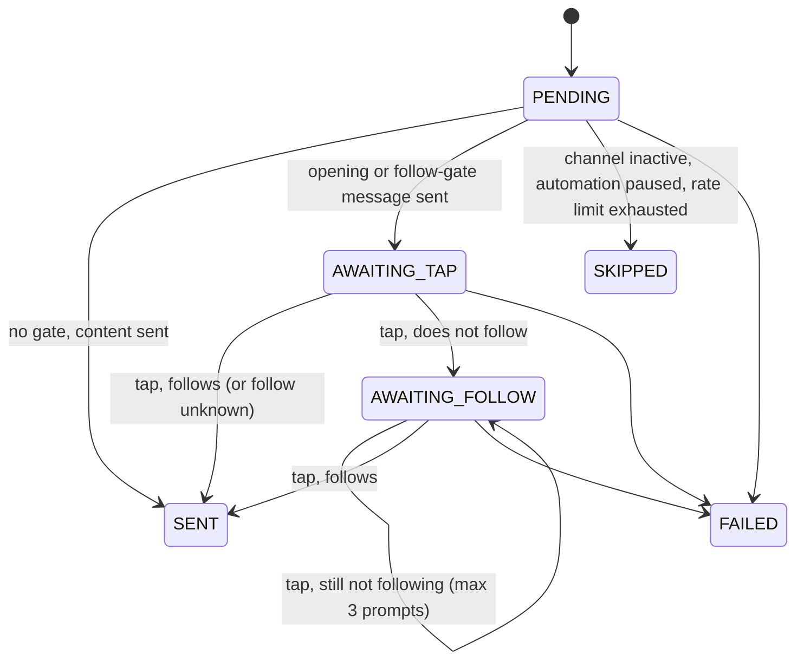

# Architecture

Conversa is a pnpm monorepo with three packages and three running processes.

| Package           | What it is                                                                                                                                                                                                 |
| ----------------- | ---------------------------------------------------------------------------------------------------------------------------------------------------------------------------------------------------------- |
| `apps/api`        | NestJS 12 (ESM). One codebase, two entry points: the HTTP API (`src/main.ts`) and the queue worker (`src/worker.ts`).                                                                                      |
| `apps/web`        | Next.js 16 App Router. The dashboard people use.                                                                                                                                                           |
| `packages/shared` | `@conversa/shared`: zod schemas, DTO types, enums, error codes, limits, keyword matching and templating. Used by both apps, so a request is validated by the same schema in the browser and on the server. |

## Processes

| Process | Command                                       | Does                                                                                                                                                                                             |
| ------- | --------------------------------------------- | ------------------------------------------------------------------------------------------------------------------------------------------------------------------------------------------------ |
| web     | `next start` (`apps/web/server.js` in Docker) | Serves the UI. Proxies `/api/*` and `/l/*` to the API (`next.config.ts` rewrites), so the browser talks to one origin and the session cookie never crosses sites. Sets the CSP (`src/proxy.ts`). |
| api     | `node dist/main.js`                           | HTTP API under `/api/v1`, plus the tracked-link redirect `/l/:slug`. Verifies and stores webhooks, then queues them. Never matches or sends automations itself.                                  |
| worker  | `node dist/worker.js`                         | A Nest application context with no HTTP server. Consumes the `inbound`, `outbound` and `maintenance` queues.                                                                                     |

Small installs can run the worker inside the API process with `WORKER_IN_API=true`. The Docker stack runs them separately.

Only the web server needs to be reachable from outside. The API is reached through it.

## API modules

`apps/api/src`:

| Path                                                 | Responsibility                                                                                                                                                                                                                                                                                                                           |
| ---------------------------------------------------- | ---------------------------------------------------------------------------------------------------------------------------------------------------------------------------------------------------------------------------------------------------------------------------------------------------------------------------------------- |
| `config/`                                            | `env.ts` parses and validates the environment with zod (fails fast, listing every problem). `AppConfig` is the only reader of `process.env`.                                                                                                                                                                                             |
| `infra/`                                             | Prisma, Redis, BullMQ queues, mail, logging (pino with redaction). Shared by API and worker.                                                                                                                                                                                                                                             |
| `common/`                                            | Crypto (encryption, signing, hashing), error type and filter, guards (origin, throttler), decorators, the zod validation pipe, client IP resolution.                                                                                                                                                                                     |
| `modules/auth`                                       | Sign-up, sign-in, MFA, password reset, sessions. Global `AuthGuard`.                                                                                                                                                                                                                                                                     |
| `modules/account`                                    | The signed-in person: profile, password, sessions, MFA setup.                                                                                                                                                                                                                                                                            |
| `modules/workspaces`                                 | Workspaces, members, roles, invitations, the audit log endpoint. Global `WorkspaceGuard`.                                                                                                                                                                                                                                                |
| `modules/channels`                                   | Connected accounts: OAuth connect, disconnect, media. Holds the provider abstraction (`provider/`), the Instagram provider (`instagram/`) and the simulated one (`sandbox/`).                                                                                                                                                            |
| `modules/webhooks`                                   | Platform webhooks and Meta's deauthorize and data deletion callbacks.                                                                                                                                                                                                                                                                    |
| `modules/engine`                                     | The automation engine (worker only): inbound processor, automation selector, delivery state machine, outbound processor, rate limiter, scope resolver, postback tokens.                                                                                                                                                                  |
| `modules/automations`                                | CRUD, status changes and duplication of automations.                                                                                                                                                                                                                                                                                     |
| `modules/links`                                      | Tracked links: slugs, `/l/:slug` redirect, click recording.                                                                                                                                                                                                                                                                              |
| `modules/buffer`                                     | Read-only Buffer integration.                                                                                                                                                                                                                                                                                                            |
| `modules/contacts`, `activity`, `inbox`, `dashboard` | Read views for the UI. The inbox reads conversations live from the platform and can send a reply.                                                                                                                                                                                                                                        |
| `modules/audit`                                      | Writes audit entries.                                                                                                                                                                                                                                                                                                                    |
| `modules/maintenance`                                | Recurring jobs: scope resolution, token refresh, cleanup.                                                                                                                                                                                                                                                                                |
| `modules/instance`                                   | `GET /instance` (what the sign-in screens need), health checks, and the instance settings: `InstanceSettingsService` (mail, Meta app, Turnstile, sign-up mode; encrypted in the database, cached in memory, reloaded everywhere through the `conversa:instance-settings` channel) and the admin routes behind `@RequireInstanceAdmin()`. |

### Request pipeline

Every HTTP request passes, in order:

1. `ClientIpMiddleware`: resolves the client IP from `X-Forwarded-For` (the web server appends its peer; `TRUST_PROXY` counts the proxies in front of it) or `CF-Connecting-IP`.
2. `AppThrottlerGuard`: Redis-backed rate limit per client IP (300 requests per minute by default, stricter on auth routes).
3. `OriginGuard`: state-changing requests must come from `APP_URL`'s origin (`@SkipOriginCheck()` for signed server-to-server callbacks).
4. `AuthGuard`: a valid session unless the route is `@Public()`.
5. `WorkspaceGuard`: for routes with `:workspaceId`, the person must be a member (otherwise **404**, so ids cannot be probed) and have the role `@RequireRole()` asks for.
6. `HttpExceptionFilter`: every error becomes `{ "error": { "code", "fields?", "requestId" } }`.

## Data model

Defined in `apps/api/prisma/schema.prisma`. Every row that belongs to a team carries `workspaceId`, and every query is scoped by it.

| Area         | Models                                                                                                                                                                                                              |
| ------------ | ------------------------------------------------------------------------------------------------------------------------------------------------------------------------------------------------------------------- |
| Identity     | `User` (argon2id hash, encrypted TOTP seed, hashed recovery codes, lockout counters), `Session` (hash of the cookie token), `PasswordReset`                                                                         |
| Teams        | `Workspace`, `Membership` (`OWNER`/`ADMIN`/`MEMBER`), `Invitation` (hashed token)                                                                                                                                   |
| Channels     | `Channel`: one connected account, `type` selects the provider, encrypted `credentials`, `status` (`ACTIVE`, `NEEDS_REAUTH`, `DISCONNECTED`). An account (`type` + `externalId`) belongs to one workspace at a time. |
| Automations  | `Automation`: trigger (`COMMENT`/`MESSAGE`), post scope (`ANY`, `SPECIFIC`, `NEXT_POST`, `BUFFER_POST`), match mode, keywords, and the `response` JSON validated by `automationResponseSchema`.                     |
| Audience     | `Contact`: one person on one channel.                                                                                                                                                                               |
| Pipeline     | `InboundEvent` (raw webhook, kept 14 days), `Delivery` (one run of one automation for one trigger)                                                                                                                  |
| Links        | `TrackedLink`, `LinkClick` (keyed hash of the visitor's IP, never the IP)                                                                                                                                           |
| Integrations | `BufferConnection` (encrypted API key)                                                                                                                                                                              |
| Audit        | `AuditLog`                                                                                                                                                                                                          |
| Instance     | `InstanceSetting`: one encrypted JSON row per section (`mail`, `instagram`, `turnstile`, `signup`). `User.isInstanceAdmin` says who may edit them.                                                                  |

## Event pipeline and idempotency

Duplicates are absorbed at every stage:

| Layer            | Guarantee                                                                                                                                             |
| ---------------- | ----------------------------------------------------------------------------------------------------------------------------------------------------- |
| Inbound job      | `jobId` is the stored event's id. A processed or ignored event is skipped on retry.                                                                   |
| Delivery         | `@@unique([automationId, triggerExternalId])`: a comment or message fires a given automation once, however often the platform redelivers the webhook. |
| Once per contact | With `oncePerContact`, an existing pending or sent delivery for the same contact stops a new one.                                                     |
| Outbound jobs    | `start-<deliveryId>`; taps are `tap-<deliveryId>-<status>-<followPrompts>`, so repeated taps on one message collapse into one job.                    |
| Delivery steps   | Each step loads the delivery, checks its status, and moves it forward only after the platform accepted the message.                                   |
| Echoes           | The account's own messages and comments (including Conversa's replies) are dropped by the parser, so replies cannot loop.                             |

### Picking the automation

`engine/automation-selector.ts`. Instagram allows one private reply per comment, and two automations answering one message would read as spam, so at most one fires. The most specific wins:

1. Bound to this post beats listening to every post.
2. A keyword match beats "anything".
3. Among equals, the newest wins.

Keyword matching (`packages/shared/src/keywords.ts`) normalises both sides: NFKC, lower case, Latin accents folded, everything that is not a letter or digit collapsed to spaces. With `wholeWord`, a keyword must match whole words.

## Delivery state machine

`engine/delivery.service.ts`.

- **Start.** For a comment, takes a private-reply slot, then sends either the gate message (with a signed postback button) or the content as a private reply. For a message, sends a normal DM.
- **Public reply.** After a comment's first send, posts one random variant under the comment. Best effort: a failure is recorded on the delivery but does not fail it.
- **Tap.** A postback whose signed payload names the delivery. With a follow gate, the contact's follow status is checked; an unknown status fails open so a real follower is never locked out.
- **Content.** The message text with `{username}` filled in, and link buttons rewritten to tracked URLs (`/l/<slug>?r=<signed delivery ref>`).

### Errors

Providers throw `ProviderError` with a `kind`:

| Kind                        | Effect                                                    |
| --------------------------- | --------------------------------------------------------- |
| `auth`                      | The channel is marked `NEEDS_REAUTH`; the delivery fails. |
| `rate_limit`, `transient`   | Retried with exponential backoff (5 attempts, from 5 s).  |
| `window_closed`, `rejected` | Permanent: the delivery fails without retrying.           |

## Queues and rate limiting

BullMQ on Valkey, key prefix `conversa`. Defaults: 5 attempts, exponential backoff from 5 s, completed jobs kept 24 h, failed jobs 7 days.

| Queue         | Processor              | Concurrency                                  |
| ------------- | ---------------------- | -------------------------------------------- |
| `inbound`     | `InboundProcessor`     | 10                                           |
| `outbound`    | `OutboundProcessor`    | 5, and at most 20 jobs per second per worker |
| `maintenance` | `MaintenanceProcessor` | 1                                            |

Maintenance schedules (upserted by every worker, so they are not duplicated):

| Task             | Every | Does                                                                                                                                                           |
| ---------------- | ----- | -------------------------------------------------------------------------------------------------------------------------------------------------------------- |
| `resolve-scopes` | 5 min | Binds `NEXT_POST` automations to the first post published after they were armed, and `BUFFER_POST` automations to the Instagram post their Buffer post became. |
| `refresh-tokens` | 6 h   | Refreshes Instagram tokens within 10 days of expiry, and re-encrypts credentials written with a previous encryption key.                                       |
| `cleanup`        | 1 day | Deletes expired sessions, used or expired password resets, invitations expired over 30 days, inbound events older than 14 days.                                |

**Private reply budget.** `engine/send-rate-limiter.ts` keeps a per-channel hourly counter in Redis (a Lua script, so every worker shares it): 750 private replies per hour. When the budget is spent the job is delayed until the window resets, up to 6 times, then the delivery is skipped as `RATE_LIMITED`. A rejected send gives its slot back.

## Provider abstraction

`modules/channels/provider/channel-provider.ts` is the only contract the rest of Conversa knows. A provider implements four capabilities:

| Interface          | Methods                                                                                                     |
| ------------------ | ----------------------------------------------------------------------------------------------------------- |
| `ChannelConnector` | `authorizationUrl`, `completeAuthorization`, `refreshCredentials`, `subscribeWebhooks`                      |
| `WebhookAdapter`   | `verifySubscription`, `verifySignature`, `parse` (to normalised `comment`, `message` and `postback` events) |
| `Messenger`        | `sendPrivateReply`, `sendMessage`, `replyToComment`, `getContactProfile`                                    |
| `ContentSource`    | `listMedia`, `getMedia`, `listConversations`, `listMessages`                                                |

Plus `type` and `isConfigured()`. Failures are thrown as `ProviderError` with one of the kinds above.

Providers are registered in `channels.module.ts` under the `CHANNEL_PROVIDERS` token and looked up through `ProviderRegistry`: `InstagramProvider` and `TikTokProvider`. With `INSTAGRAM_SANDBOX=true`, `SandboxInstagramProvider` and `SandboxTikTokProvider` take their place.

What a platform cannot do is declared, not discovered: `CHANNEL_CAPABILITIES` in `packages/shared/src/capabilities.ts` says whether comments can start automations, whether messages have link buttons, how long a tap payload may be, and whether follow status is looked up or arrives with webhooks. The engine, the automation API and the editor read it; the provider throws `ProviderError('rejected')` for anything it cannot do.

### Adding a platform

1. Add the value to `ChannelType` in `prisma/schema.prisma` and `packages/shared/src/enums.ts`, and create a migration (`pnpm db:migrate`).
2. Write `modules/channels/<platform>/<platform>.provider.ts` implementing `ChannelProvider`, with a webhook parser and its unit tests. Map platform errors to `ProviderError` kinds.
3. Add its app credentials as a section of `InstanceSettingsService` (a shared zod schema, a typed getter, a section of the admin page); `isConfigured()` reads them.
4. Register it in the `CHANNEL_PROVIDERS` factory in `channels.module.ts`.
5. Allow the type in the `channelType` parser of `channels.controller.ts`.
6. The webhook routes are generic (`/api/v1/webhooks/:type`), and so is OAuth (`/api/v1/channels/oauth/:type/callback`). The engine needs no change.
7. In the web app, add the platform's words to `messages/en` and `messages/es` (channels, errors) and its connect button.
8. Document its app setup in `docs/<platform>.md`.

The step-by-step version is `.claude/commands/new-channel-provider.md`.

## Internationalisation

- The API never sends prose. Errors are stable codes (`packages/shared/src/errors.ts`); the web app translates them. The only server-side text is email (`infra/mail/templates.ts`): a password reset goes out in the person's saved locale, an invitation in the inviter's.
- The web app uses `next-intl` without locale routing: the locale comes from the `conversa_locale` cookie, then the browser's `Accept-Language`. Messages live in `apps/web/messages/<locale>/<area>.json`; the English tree types every key, so a missing key fails `tsc`.
- Mola UI's own built-in words are translated in `apps/web/src/i18n/mola-es.ts`.

See [i18n.md](i18n.md) to add a language.
